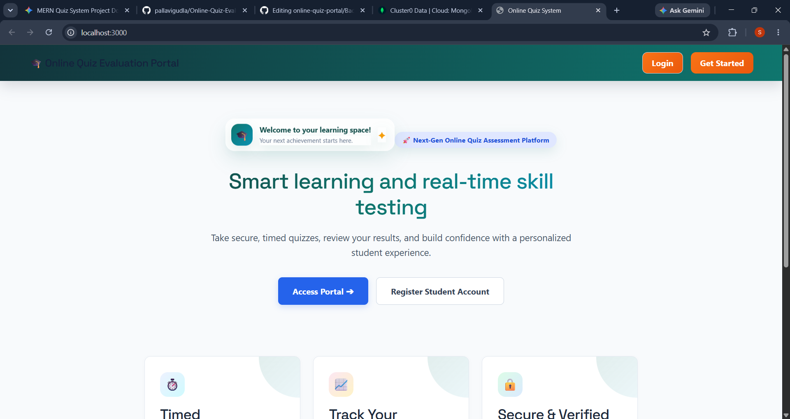
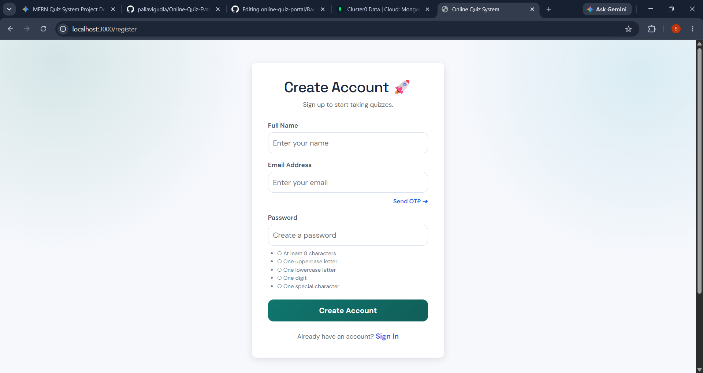
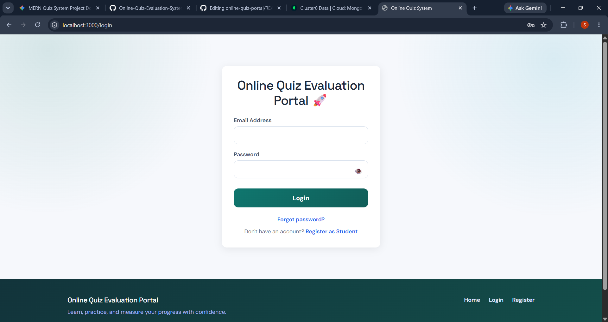
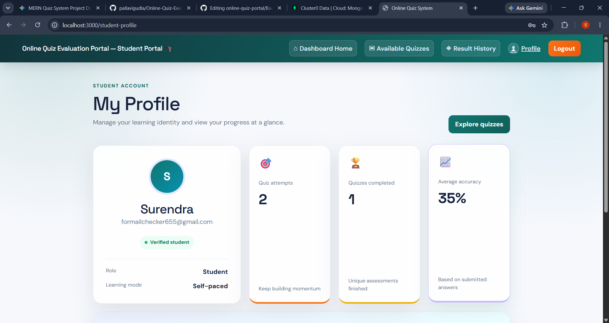
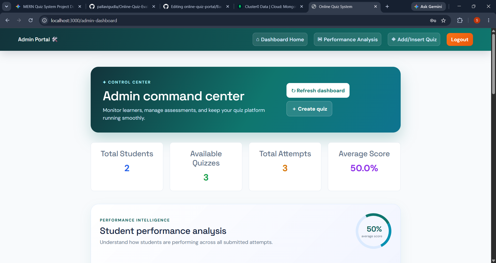
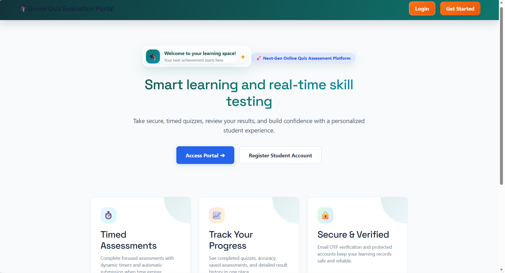
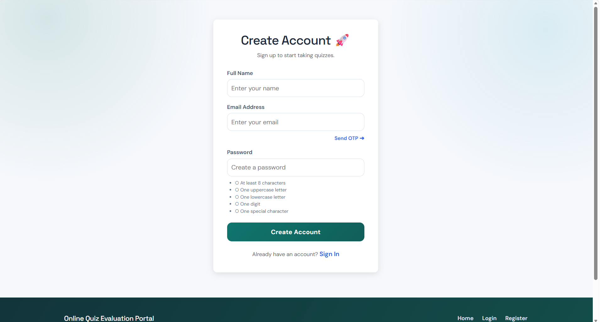
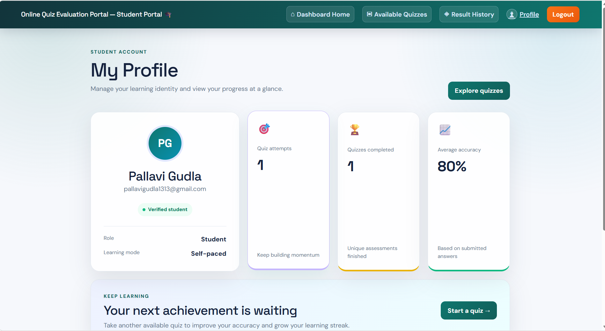
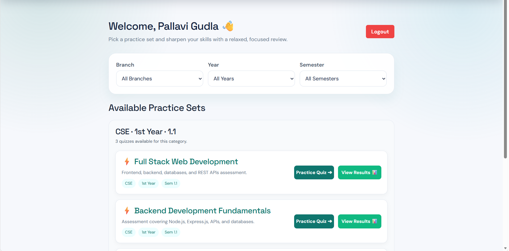

<<<<<<< HEAD
# 📝 Online Quiz Evaluation System
=======
# 📝 Online Quiz Evaluation System
>>>>>>> 377bf120e5a22eb638834a6e13d6285a56521b05

A full-stack MERN-based Online Quiz Evaluation System developed as part of the Full Stack Development (FSD-2) course.

## 🚀 Features

### Authentication
<<<<<<< HEAD
- User Registration
- Email OTP Verification
- Login using JWT Authentication
- Role-Based Access (Admin & Student)

### Student Module
- View Available Quizzes
- Start Quiz
- Attempt Questions
- Submit Quiz
- Automatic Score Calculation
- View Result

### Admin Module
- Admin Login
- Create Quiz
- Add Questions
- View Quiz Results
- Manage Quizzes
=======

* User Registration
* Email OTP Verification
* Login using JWT Authentication
* Role-Based Access (Admin & Student)

### Student Module

* View Available Quizzes
* Start Quiz
* Attempt Questions
* Submit Quiz
* Automatic Score Calculation
* View Result

### Admin Module

* Admin Login
* Create Quiz
* Add Questions
* View Quiz Results
* Manage Quizzes
>>>>>>> 377bf120e5a22eb638834a6e13d6285a56521b05

---

## 🛠 Tech Stack

### Frontend
<<<<<<< HEAD
- React.js
- React Router DOM
- Axios
- Bootstrap
- Vite

### Backend
- Node.js
- Express.js
- JWT Authentication
- Nodemailer

### Database
- MongoDB Atlas
- Mongoose
=======

* React.js
* React Router DOM
* Axios
* Bootstrap
* Vite

### Backend

* Node.js
* Express.js
* JWT Authentication
* Nodemailer

### Database

* MongoDB Atlas
* Mongoose
>>>>>>> 377bf120e5a22eb638834a6e13d6285a56521b05

---

## 📂 Project Structure

<<<<<<< HEAD
```bash
online-quiz-portal
├── Backend/
=======
```text
Online-Quiz-Evaluation-System
│
├── Backend/
│   ├── config/
>>>>>>> 377bf120e5a22eb638834a6e13d6285a56521b05
│   ├── controllers/
│   ├── middleware/
│   ├── models/
│   ├── routes/
<<<<<<< HEAD
│   ├── config/
│   ├── server.js
│   └── package.json
├── Frontend/
│   ├── src/
│   │   ├── pages/
│   │   ├── components/
│   │   ├── services/
│   │   └── App.jsx
│   └── package.json
├── .gitignore
├── README.md
├── Screenshots/
│   ├── Home.png
│   ├── Login.png
│   ├── Register.png
│   ├── StudentDashboard.png
│   └── AdminDashboard.png
└── package.json
=======
│   ├── services/
│   ├── utils/
│   ├── seedAdmins.js
│   ├── server.js
│   └── package.json
│
├── Frontend/
│   ├── public/
│   ├── src/
│   │   ├── components/
│   │   ├── pages/
│   │   ├── services/
│   │   ├── App.jsx
│   │   ├── App.css
│   │   └── index.js
│   └── package.json
│
├── screenshots/
│   ├── home.png
│   ├── register.png
│   ├── student-dashboard.png
│   └── quiz.png
│
├── .gitignore
└── README.md
>>>>>>> 377bf120e5a22eb638834a6e13d6285a56521b05
```

---

## ⚙️ Installation

### Clone Repository

```bash
<<<<<<< HEAD
git clone https://github.com/SURENDRATHONTA/online-quiz-portal.git
cd online-quiz-portal
=======
git clone https://github.com/pallavigudla/Online-Quiz-Evaluation-System.git
cd Online-Quiz-Evaluation-System
>>>>>>> 377bf120e5a22eb638834a6e13d6285a56521b05
```

### Backend Setup

<<<<<<< HEAD
=======
Open a terminal and run:

>>>>>>> 377bf120e5a22eb638834a6e13d6285a56521b05
```bash
cd Backend
npm install
npm run dev
```

<<<<<<< HEAD
### Frontend Setup

```bash
cd ../Frontend
npm install
npm run dev
=======
The backend server will run on:

```text
http://localhost:5000
```

### Frontend Setup

Open a **new terminal** and run:

```bash
cd Frontend
npm install
npm start
```

The frontend will run on:

```text
http://localhost:3000
>>>>>>> 377bf120e5a22eb638834a6e13d6285a56521b05
```

---

## 🔐 Environment Variables

Create a `.env` file inside the `Backend` folder.

```env
MONGO_URI=your_mongodb_connection_string
JWT_SECRET=your_secret_key
EMAIL_USER=your_email
EMAIL_PASS=your_app_password
PORT=5000
<<<<<<< HEAD
```

---

## 📸 Screenshots

### Home Page


### Register Page


### Login Page


### Student Dashboard


### Admin Dashboard

=======
## 📸 Screenshots

### 🏠 Home Page

<p align="center">
  
</p>

### 📝 Register Page

<p align="center">
  
</p>

### 👨‍🎓 Student Dashboard

<p align="center">
  
</p>

### 📝 Quiz Page

<p align="center">
  
</p>
>>>>>>> 377bf120e5a22eb638834a6e13d6285a56521b05

---

## 👨‍💻 Team Members

<<<<<<< HEAD
| Name | Role |
|------|------|
| Surendra Thonta | Developer |
| Sanjay Kumar Vadali | Developer |
| Shankar Palli | Developer |
| Jhansi Kagani | Developer |
| Pallavi Siri Gudla | Developer |
=======
| Name        | Role      |
| ------------| --------- |
| Jhansi Rani | Developer |
| Surendra    | Developer |
| Pallavi Siri| Developer |
| Sanjay      | Developer |
| Siva Shankar| Developer |
>>>>>>> 377bf120e5a22eb638834a6e13d6285a56521b05

---

## 📚 Academic Project

**Course:** Full Stack Development (FSD-2)

**Technology:** MERN Stack

**Institution:** Sri Vasavi Engineering College

---

## ⭐ Future Enhancements

<<<<<<< HEAD
- Timer for Quiz
- Leaderboard
- Certificate Generation
- Quiz Analytics
- Responsive UI
- Dark Mode
=======
* Timer for Quiz
* Leaderboard
* Certificate Generation
* Quiz Analytics
* Responsive UI
* Dark Mode
>>>>>>> 377bf120e5a22eb638834a6e13d6285a56521b05

---

## 📄 License

This project is developed for educational purposes.
